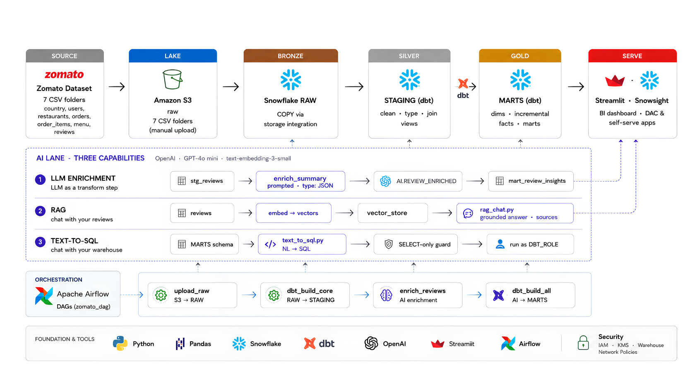

# Zomato Data Engineering Pipeline

[](https://zomato-ai-pipeline.streamlit.app)

An end-to-end batch data pipeline built on Apache Airflow 3, DuckDB, and large language models. Airflow transforms the local food-delivery CSVs into a validated, deployable DuckDB analytics artifact, which powers a conversational analytics application without a live warehouse dependency.

---

## Architecture



---

## Overview

The pipeline processes seven source datasets representing the core entities of a food delivery platform — restaurants, users, menus, food items, orders, order line items, and customer reviews. Airflow turns the CSV source layer into a compact DuckDB serving database containing the full review corpus and curated analytics marts. The entire refresh is orchestrated by a daily Airflow DAG running inside Docker.

**Key engineering characteristics:**

- Full-refresh DuckDB artifact generation from the authoritative CSV sources
- Atomic artifact publication so an unsuccessful refresh does not replace the last valid database
- Post-build validation of required tables, review counts, and core serving marts
- Retrieval-Augmented Generation (RAG) over vectorised review embeddings for conversational analytics
- Natural-language-to-SQL translation backed by a schema-aware system prompt

---

## Technology Stack

| Layer | Technology |
|---|---|
| Pipeline & Serving Store | DuckDB |
| Dashboard Analytics Store | DuckDB (deployable serving layer) |
| Orchestration | Apache Airflow 3 (Docker, LocalExecutor) |
| Transformation | Reproducible Python + DuckDB SQL builder |
| LLM Inference | Groq API (OpenAI-compatible, `openai/gpt-oss-20b`) |
| Review Retrieval | TF-IDF bi-gram index (`scikit-learn`) |
| Analytics Artifact | Compact DuckDB database (~15 MB from local source data) |
| Analytics Application | Streamlit |
| Containerisation | Docker Compose |
| Source Control | GitHub |
| Cloud Deployment | Streamlit Community Cloud |

---

## Repository Structure

```
zomato-de-pipeline/
├── airflow/
│   ├── Dockerfile                  # Custom Airflow 3 image with DuckDB
│   ├── docker-compose.yaml         # Services: postgres, airflow-init, apiserver, scheduler, dag-processor
│   └── dags/
│       └── zomato_batch.py         # DuckDB refresh and validation DAG (daily schedule)
│
├── zomato/                         # dbt project root
│   ├── dbt_project.yml             # Project config: materialization defaults, schema targets
│   ├── profiles.yml                # Snowflake connection profile (git-ignored)
│   └── models/
│       ├── staging/                # Source-aligned views: type casting, column renaming, filtering
│       │   ├── _sources.yml        # RAW schema source declarations
│       │   ├── _ai_sources.yml     # AI schema source declaration (REVIEW_ENRICHED)
│       │   ├── _staging.yml        # Staging model data quality tests
│       │   ├── stg_orders.sql
│       │   ├── stg_order_items.sql
│       │   ├── stg_restaurants.sql
│       │   ├── stg_users.sql
│       │   ├── stg_food.sql
│       │   ├── stg_menu.sql
│       │   └── stg_reviews.sql
│       └── marts/                  # Business-layer tables and aggregate marts
│           ├── _marts.yml          # Referential integrity and accepted-values tests
│           ├── fact_orders.sql     # Incremental fact table (merge strategy)
│           ├── fact_order_items.sql
│           ├── dim_customer.sql    # Includes derived age_segment column
│           ├── dim_restaurants.sql
│           ├── dim_date.sql
│           ├── mart_daily_city_revenue.sql
│           ├── mart_restaurant_performance.sql
│           ├── mart_delivery_sla.sql
│           └── mart_review_insights.sql   # tag:ai — built after LLM enrichment
│
├── ai/
│   ├── enrich_reviews.py           # Batch LLM enrichment: classifies review sentiment and topics
│   ├── rag_chat.py                 # Standalone RAG Streamlit application (per-app entrypoint)
│   ├── text_to_sql.py              # Standalone Text-to-SQL Streamlit application
│   ├── app.py                      # Unified multi-tab Streamlit hub
│   ├── build_analytics_db.py       # Atomically builds the serving layer from CSVs
│   ├── validate_analytics_db.py    # Checks the artifact after every Airflow refresh
│   └── zomato_analytics.duckdb     # Compact analytics artifact used by Streamlit
│   └── requirements.txt            # Python dependencies for AI layer
│
├── data/                           # Authoritative source CSVs (mounted read-only into Airflow)
├── architecture.png                # End-to-end pipeline diagram
├── requirements.txt                # Root-level requirements for Streamlit Cloud
├── app.py                          # Root entrypoint that delegates to ai/app.py
└── .gitignore
```

---

## Historical Snowflake/dbt Design (legacy reference)

The sections below document the original Snowflake/dbt implementation. They are retained as project history and are not invoked by the active Docker Compose stack or the `zomato_duckdb_refresh` DAG.

## Data Pipeline: Stage-by-Stage

### 1. Ingestion — Snowflake COPY INTO

Raw CSV files are uploaded to a named Snowflake internal stage (`ZOMATO.RAW.ZOMATO_RAW_STAGE`) partitioned by entity. The Airflow `reload_raw` task issues `COPY INTO` statements for all seven tables using Snowflake's bulk loader, which parallelises file reads, enforces schema, and logs per-file load metadata in `INFORMATION_SCHEMA.LOAD_HISTORY`.

**Source datasets (approximate sizes):**

| Table | File Size |
|---|---|
| `orders` | ~1.3 GB |
| `order_items` | ~955 MB |
| `menu` | ~66 MB |
| `restaurant` | ~47 MB |
| `reviews` | ~25 MB |
| `food` | ~17 MB |
| `users` | ~11 MB |

### 2. Staging — dbt Views (`ZOMATO.STAGING`)

Staging models are materialised as **views** — they add no storage cost and always reflect the current state of the RAW layer. Responsibilities at this layer:

- **Type coercion**: casting raw strings to `NUMBER`, `DATE`, `STRING` using explicit Snowflake cast operators.
- **Column standardisation**: renaming source-specific keys (`user_id` → `customer_id`, `r_id` → `restaurant_id`) to a unified vocabulary used downstream.
- **Derived boolean flags**: `(order_status = 'Delivered') AS is_delivered` replaces repeated `CASE` expressions across downstream models.
- **City extraction**: `REGEXP_SUBSTR` + `TRIM` normalises inconsistently formatted city strings from the orders source.
- **Null filtering**: `stg_reviews` excludes rows where `comment IS NULL`, preventing empty strings from entering the LLM enrichment pipeline.
- **Cross-entity join at staging**: `stg_reviews` joins to `stg_restaurants` to propagate the `city` attribute onto reviews, enabling city-level sentiment aggregation in the AI mart without requiring a runtime join.

**Data quality tests** are declared in `_staging.yml` and `_marts.yml`:

```yaml
# Examples
- name: order_id
  tests: [unique, not_null]
- name: order_status
  tests:
    - accepted_values: { values: ['Delivered', 'Cancelled', 'Refunded'] }
- name: customer_id
  tests:
    - relationships: { to: ref('dim_customer'), field: customer_id }
```

### 3. Marts — dbt Tables (`ZOMATO.MARTS`)

Marts are materialised as **tables** in Snowflake, pre-computed and query-optimised for analytical access patterns.

#### Dimensional Model

The mart layer follows a **star schema** design:

| Model | Type | Description |
|---|---|---|
| `FACT_ORDERS` | Fact (incremental) | One row per order. Central transactional table. |
| `FACT_ORDER_ITEMS` | Fact | One row per line item within an order. |
| `DIM_CUSTOMER` | Dimension | Demographic profile with derived `age_segment` (Gen Z / Millennial / Gen X / Boomer). |
| `DIM_RESTAURANTS` | Dimension | Restaurant attributes: name, city, cuisine, rating, cost. |
| `DIM_DATE` | Dimension | Calendar spine with `is_weekend` flag for temporal analysis. |

#### Incremental Strategy on `FACT_ORDERS`

```sql
{{ config(
    materialized='incremental',
    unique_key='order_id',
    incremental_strategy='merge',
    on_schema_change='append_new_columns'
) }}
...

  where order_timestamp > (select coalesce(max(order_timestamp), '1900-01-01'::timestamp) from {{ this }})

```

On each pipeline run, dbt computes a high-water mark from `max(order_timestamp)` in the existing table and only processes rows newer than that threshold. The `merge` strategy ensures late-arriving or corrected records upsert correctly via `order_id` as the unique key.

#### Pre-Aggregated Mart Tables

| Mart | Grain | Key Metrics |
|---|---|---|
| `MART_DAILY_CITY_REVENUE` | `order_date, city` | GMV, AOV, order count, cancellation rate |
| `MART_RESTAURANT_PERFORMANCE` | `restaurant_id` | Revenue, average rating, average delivery time |
| `MART_DELIVERY_SLA` | `city, order_hour` | P50 (median) and P90 delivery minutes |
| `MART_REVIEW_INSIGHTS` | `city, topic, sentiment_label` | Average sentiment score, average star rating, flagged issue count |

**Business metric definitions encoded in the mart layer:**

- **GMV** (Gross Merchandise Value): `SUM(sales_amount) WHERE is_delivered = TRUE` — delivered revenue only, excluding cancelled and refunded orders.
- **AOV** (Average Order Value): `DIV0(GMV, delivered_orders)` — Snowflake's null-safe division prevents divide-by-zero errors.
- **Cancel Rate**: `DIV0(COUNT_IF(order_status = 'Cancelled'), COUNT(*))` — computed at daily city grain.
- **P90 Delivery SLA**: `PERCENTILE_CONT(0.9) WITHIN GROUP (ORDER BY delivery_time_min)` — 90th-percentile delivery time per city per hour of day.

### 4. LLM Enrichment — `ZOMATO.AI.REVIEW_ENRICHED`

`ai/enrich_reviews.py` runs as the third Airflow task (`enrich_reviews`). It:

1. Connects to Snowflake and creates `ZOMATO.AI` schema and `REVIEW_ENRICHED` table if they do not exist.
2. Queries `ZOMATO.RAW.REVIEWS` for reviews not yet present in `REVIEW_ENRICHED` (idempotent exclusion filter).
3. For each review, sends the comment text to the Groq API with a structured JSON prompt requesting:
   - `sentiment_label`: `positive`, `negative`, or `neutral`
   - `sentiment_score`: float between -1.0 and 1.0
   - `topic`: one of `food quality`, `delivery`, `pricing`, `service`, `packaging`, `other`
   - `key_issue`: a short phrase describing the primary complaint, or `null`
4. Inserts all results in a single `executemany` call.

The `SAMPLE_N` environment variable controls how many reviews are processed per run, allowing the batch size to be tuned without a code change.

### 5. AI Mart Build — `MART_REVIEW_INSIGHTS`

After enrichment completes, the final Airflow task (`dbt_build_ai`) runs `dbt build --select tag:ai`, which targets only models tagged with `ai`. `MART_REVIEW_INSIGHTS` joins `REVIEW_ENRICHED` to `stg_reviews` on `review_id` and aggregates sentiment metrics by `city`, `topic`, and `sentiment_label`.

The deliberate tag-based split prevents this mart from being attempted during `dbt_build_core`, when the AI schema may not yet contain fresh data.

---

## Orchestration — Apache Airflow 3

### Current DAG: `zomato_duckdb_refresh`

```
CSV source files (read-only mount)
    >> build_duckdb_serving_layer
    >> validate_duckdb_serving_layer
```

| Task | Operator | Description |
|---|---|---|
| `build_duckdb_serving_layer` | `BashOperator` | Runs `build_analytics_db.py` against `/opt/airflow/data` and atomically publishes `ai/zomato_analytics.duckdb`. |
| `validate_duckdb_serving_layer` | `BashOperator` | Opens the published database read-only and verifies its required tables, full review count, and city/day mart. |

**Schedule**: `@daily`, `catchup=False` — runs once per calendar day, does not backfill missed runs. The application consumes the completed artifact; it does not query Airflow or any warehouse at request time.

### Airflow 3 Architecture

This project uses **Apache Airflow 3**, which introduces a decomposed service model compared to Airflow 2:

| Service | Role |
|---|---|
| `apiserver` | Replaces the legacy `webserver`; exposes the REST API and serves the React UI on port 8080 |
| `scheduler` | Parses no DAGs; solely handles scheduling, triggering, and state management |
| `dag-processor` | Dedicated process for parsing and serialising DAG files |
| `postgres` | Airflow metadata database |

Inter-component communication uses JWT-signed requests. The `AIRFLOW__CORE__EXECUTION_API_SERVER_URL` must point to the `apiserver` service by its Docker network hostname, not `localhost`, to avoid task state mismatches in multi-container deployments.

### Custom Docker Image

The Airflow image contains only the required DuckDB runtime plus the FAB provider for the local UI login. This removes warehouse credentials, Snowflake provider packages, dbt, and LLM credentials from the orchestrator:

```dockerfile
FROM apache/airflow:3.0.3-python3.11
RUN pip install --no-cache-dir \
      apache-airflow-providers-fab
RUN PIP_CONSTRAINT= pip install --no-deps "duckdb==1.1.3"
```

---

## Analytics Application — Streamlit

`ai/app.py` is the unified application exposing two tools through a tab interface:

### Tab 1: Review Intelligence (RAG)

A Retrieval-Augmented Generation system over customer review text.

**Embedding and retrieval:**

1. On demand, `load_reviews()` reads the full review corpus from the local DuckDB serving layer and builds a TF-IDF bi-gram index in memory.
2. TF-IDF gives higher weight to terms distinctive to a review; L2 normalisation prepares the document-term matrix for cosine-similarity ranking. The vocabulary is bounded to 100,000 recurring terms and phrases to control memory without excluding any reviews from retrieval.
3. At query time, the question is transformed by the same vectorizer. A sparse matrix dot product ranks the full review corpus without a remote model download or a separate vector database.
4. The top-K most similar reviews are retrieved and passed as structured context to the Groq LLM, which synthesises a grounded natural-language answer.

**Performance characteristics**: The bounded sparse TF-IDF matrix makes full-corpus retrieval practical on CPU, without a vector database or Hugging Face model download.

### Tab 2: SQL Data Analyst (Text-to-SQL)

A natural-language-to-SQL interface against a compact DuckDB serving layer.

- A schema-aware system prompt encodes the dashboard's aggregate marts and business metric definitions (GMV, AOV, cancel rate, SLA percentiles).
- The Groq LLM returns a JSON object `{"sql": "..."}` which is parsed and executed by DuckDB.
- A **SQL safety guard** (`is_safe_sql`) rejects any statement that does not begin with `SELECT` or `WITH`, or contains DML/DDL keywords, before execution.
- Results are rendered as an interactive `st.dataframe`. Two-column numeric results automatically generate a bar chart.

---

## Snowflake Schema Design (legacy reference)

```
ZOMATO (database)
├── RAW          ← COPY INTO from internal stage; raw source tables
├── STAGING      ← dbt views; typed, renamed, filtered
├── MARTS        ← dbt tables; star schema + pre-aggregated marts
└── AI           ← LLM enrichment output (REVIEW_ENRICHED)
```

---

## Installation and Setup

### Prerequisites

- Docker Desktop
- Python 3.11+
- A Groq API key ([console.groq.com](https://console.groq.com))
- Git

---

### 1. Clone the Repository

```bash
git clone https://github.com/Daksh1119/zomato-de-pipeline.git
cd zomato-de-pipeline
```

### 2. Supply the Source Data

Place the seven CSV source files in `data/`. Airflow mounts this directory read-only, so the source data remains the system of record while each run writes only the derived `ai/zomato_analytics.duckdb` artifact.

### 3. Configure the Dashboard Key

Create an `.env` file in `ai/` for local Streamlit development:

```bash
cp ai/.env.example ai/.env
```

**`ai/.env.example`:**

```dotenv
GROQ_API_KEY=gsk_your_groq_api_key
```

### 4. Start Airflow

```bash
cd airflow
docker compose build
docker compose up -d
```

Wait for `airflow-init` to complete (approximately 60 seconds), then access the Airflow UI at [http://localhost:8080](http://localhost:8080) with credentials `admin / admin`.

In the Airflow UI, enable and trigger `zomato_duckdb_refresh`. A healthy run completes both build and validation tasks. No Snowflake connection or Airflow secret is required.

### 5. Run the Streamlit Application Locally

```bash
pip install -r requirements.txt
python ai/build_analytics_db.py
streamlit run app.py
```

The builder reads the git-ignored source CSVs and creates a compact `ai/zomato_analytics.duckdb` artifact. The application will be available at [http://localhost:8501](http://localhost:8501).

---

## Streamlit Cloud Deployment

The application is deployable directly from GitHub at [share.streamlit.io](https://share.streamlit.io).

| Setting | Value |
|---|---|
| Repository | `Daksh1119/zomato-de-pipeline` |
| Branch | `main` |
| Main file path | `app.py` |
| Python version | `3.11` |

Commit `ai/zomato_analytics.duckdb` with the application. In **Advanced Settings → Secrets**, only add the Groq key in TOML format:

```toml
GROQ_API_KEY = "gsk_your_groq_api_key"
```

Snowflake remains an optional upstream warehouse for the Airflow and dbt pipeline. The public dashboard does not require Snowflake credentials or a running warehouse.

---

## Key Engineering Decisions

**Incremental loading over full refresh**: `FACT_ORDERS` uses a high-water mark on `order_timestamp` with merge deduplication. This reduces Snowflake compute credits and query time proportional to the day's delta rather than the full table size.

**dbt venv isolation**: Installing `dbt-snowflake` inside a virtualenv inside the Airflow container avoids dependency resolver conflicts between dbt's pinned packages and Airflow's provider ecosystem.

**Tag-based DAG splitting**: Tagging `mart_review_insights` with `tag:ai` and splitting `dbt_build_core` and `dbt_build_ai` into separate Airflow tasks ensures that the AI mart is never built before the enrichment step has written its data. It also allows the core dimensional model to be rebuilt independently.

**DuckDB serving layer**: The builder transforms multi-gigabyte source files into a small read-only analytics artifact. This separates the heavy batch workload from interactive dashboard serving and removes the warehouse dependency from the deployed app.

**Groq as LLM provider**: Groq's inference engine delivers low-latency responses suitable for interactive applications. The OpenAI-compatible API surface means the client code requires no provider-specific SDK.

**`DIV0` and `COUNT_IF` for analytical safety**: Snowflake-native functions `DIV0` (null-safe division) and `COUNT_IF` (conditional aggregation without `CASE WHEN`) are used throughout the mart layer for correctness and readability.

---

## Security

- All credentials are managed via environment variables and are never committed to version control.
- `profiles.yml` is covered by `.gitignore`.
- `ai/.env` and `airflow/.env` are covered by `.gitignore`.
- Source data CSVs and generated parquet files are excluded from git via `data/` and `*.parquet` patterns.
- The Text-to-SQL application enforces a read-only guard: generated SQL is rejected if it does not begin with `SELECT` or `WITH`, or if it contains any DML or DDL keyword.
